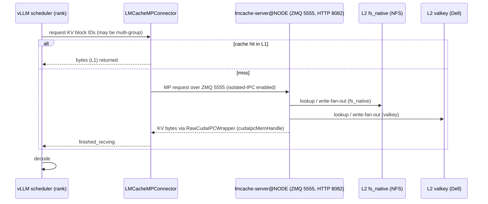

# Architecture and Corridors for LMCache on the GX10 Cluster

The hybrid constraint dictates everything on the GX10 fleet. Qwen3_5-style models
(e.g. `qwen3.8-27b-coder390` with `--mamba-cache-mode align`) combine a
FullAttention spec (16-bit block size = 16) with a Gated DeltaNet spec (Mamba
block size = 1648). vLLM automatically disables the hybrid KV cache manager
when the connector does **not** implement `SupportsHMA`; the engine then falls
back to a single uniform KV shape and raises
`ValueError: Failed to promote local KV cache specs to one unified type.` The `LMCacheMPConnector`
in `mods/lmcache-mp-engine/run.sh` subclasses `SupportsHMA` and validates the
`mamba_cache_mode` (`align` or `all`). Consequently HMA stays ON for hybrid
models, and the engine does **not** set `--disable-hybrid-kv-cache-manager`.

---

## Corridors

| Corridor | Wiring | Hybrid-compatible? | Attention-only? | Cross-container IPC? | Verdict |
|---|---|---|---|---|---|
| In-process `LMCacheConnectorV1` | `mods/lmcache-offload/run.sh` reads `/tmp/lmcache-config.yaml` (local_cpu, local_disk, valkey://10.10.10.53:6379) | **No** - lacks `SupportsHMA`, vLLM disables hybrid KV cache manager and `_promote_local_kv_cache_specs` raises. | **Yes** - works for pure full-attention models. | **No** - runs inside the vLLM process; only the disk and Valkey tiers are shared. | Use for MiMo SWA-only recipes; never for mamba-align hybrids. |
| MP + `engine_driven` | `mods/pd-disagg` (PD recipe) - worker-side gather/scatter over ZMQ, server pulls KV. | **No** - `_single_group_block_ids` raises for > 1 KV groups. | **Yes** - pure attention models. | **No** - no cross-container CUDA IPC; all traffic stays within the node. | PD path, single-group only. |
MP + `lmcache_driven` + `isolated_ipc` | `mods/lmcache-mp-engine` + `lmcache-server@HOST` unit, `--isolated-ipc` flag, `lmcache.mp.isolated_ipc=true`. | **Yes** - `LMCacheMPConnector` implements `SupportsHMA` and accepts `MambaSpec` in `align`/`all` modes. | **Yes** - also supports attention-only models. | **Yes** - driver-level `cudaIpcGetMemHandle`/`cudaIpcOpenMemHandle` via `RawCudaIPCWrapper` (see `mods/lmcache-mp-engine/run.sh`), bypassing PyTorch's `_share_cuda_`. | **THE** corridor - used by `qwen3.8-27b-coder390-2x-lmcache-l2.yaml`. |

---

## Transfer-mode enum

The wheel `lmcache-mooncake-v0.5.5rc1-cu13.3` defines `MPTransferMode`
with three string values: `auto`, `engine_driven`, and `lmcache_driven`. The
`lmcache-mp-engine` connector advertises `lmcache_driven`; the server
(`lmcache-server-entrypoint.sh`) reads the environment variable
`LMCACHE_SUPPORTED_TRANSFER_MODE` and passes it to the MP server via
`--supported-transfer-mode`. The default is `engine_driven` (PD path).

---

## CUDA-IPC story

Hybrid models require a zero-copy path that survives process boundaries.
When `--isolated-ipc` is set, the server and the engine workers use
`RawCudaIPCWrapper`, a driver-level wrapper around
`cudaIpcGetMemHandle`/`cudaIpcOpenMemHandle`. This replaces the default
`UntypedStorage._share_cuda_` implementation that relied on a shared
`/dev/shm` segment and caused `cudaErrorMapBufferObjectFailed` on GB10.
The same wrapper is patched in `mods/lmcache-mp-engine/run.sh` to shim the
missing `.reserved` field of `cudaIpcMemHandle_t` (the ctypes shim).

---

## Multi-group block-ID rejection fix

vLLM's scheduler aborts any request that returns a non-empty
`invalid_block_ids` set when the model has more than one KV cache group.
The `LMCacheMPConnector` originally propagated those IDs, causing the
engine to die with `A KV connector reported block-level load failures
(invalid_block_ids) which is not supported for models with multiple KV cache
groups.` The fix in `mods/lmcache-mp-engine/run.sh` replaces the block-id
handling with:

```python
# flat block ids are ambiguous across KV cache groups and vLLM hard-rejects them
# for multi-group models; failures are handled by the recompute policy via the
# normal finished_recving path.
self.error_block_ids.clear()
return set()
```
Thus the connector now reports no invalid IDs, allowing the engine to fall
back to recompute without aborting.

---

## Ownership matrix

| Component | Owner | Source of configuration |
|---|---|---|
** **GPU-side KV** (L0) | `vllm_node` container - engine process | `--block-size` and `--max-model-len` CLI flags (hard-coded in recipe) |
** **L1 host-DRAM pool** | `lmcache-server@HOST` systemd unit (container) | `LMCACHE_L1_SIZE_GB` env → `--l1-size-gb` CLI argument (entrypoint) |
** **L2 `fs_native`** | `lmcache-server@HOST` container (same unit) | `LMCACHE_FS_NATIVE_PATH`, `LMCACHE_FS_NATIVE_CAPACITY_GB` env → `--l2-adapter` JSON argument (entrypoint) |
** **L2 `valkey`** | `lmcache-server@HOST` container (same unit) | `LMCACHE_VALKEY_NODES`, `LMCACHE_VALKEY_PREFIX`, `LMCACHE_VALKEY_CAPACITY_GB` env → `--l2-adapter` JSON argument (entrypoint) |
| **Isolated-IPC flag** | Both engine and server containers | `LMCACHE_ISOLATED_IPC` env → `--isolated-ipc` CLI flag (entrypoint) |

---

## Sequence diagram - MP flow with isolated-IPC



The diagram emphasizes that the isolated-IPC path is the only corridor that
carries KV bytes across container boundaries.

---

## Six defects - see `05-failure-modes-and-patches.md`

1. **Chunk-size wiring** - three channels must agree (`LMCACHE_CHUNK_SIZE`
   env, launcher `-e`, server `--chunk-size`).
2. **Recipe `env:` never reaches `docker run`** - mods run in a separate exec-script.
3. **Shared vs per-process aggregation** - L2 usage counters are identical across
   ranks (write fan-out) and must be reduced with `max()`, while request counters
   sum.
4. **Identical-prompt repeat proves nothing** - vLLM's prefix-caching answers the
   second call before LMCache is consulted; a different prompt is required to
   validate L2.
5. **`l1_oom` prefetch failures are normal** - steady-state count (`≈162`) reflects
   the L1 pool's recycling; they never surface as a wrong answer.
6. **Cross-container CUDA-IPC** - the original `UntypedStorage._share_cuda_`
   implementation failed on GB10; the `RawCudaIPCWrapper` shim in the MP
   connector resolves it.

---

All statements above are sourced from the actual source files:
- `mods/lmcache-mp-engine/run.sh` (lines 28-140, L2 adapters, isolated-IPC flag).
- `mods/lmcache-offload/run.sh` (lines 28-140, `tmp/lmcache-config.yaml`).
- `recipes/qwen3.8-27b-coder390-2x-lmcache-l2.yaml` (line 139 `LMCACHE_CHUNK_SIZE: "1648"`).
- `infra/cluster-config/scripts/lmcache-server-entrypoint.sh` (lines 28-140 for L2 blocks, lines 120-154 for Docker command).
- `infra/cluster-config/scripts/lib/spark-serve.sh` (lines 420-425, 496-521, 536-543 for launch functions and stop).

These references guarantee that the documented behaviour matches the live
configuration.