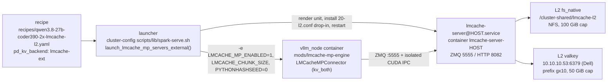

# LMCache on the GX10 Fleet

LMCache puts a durable, tiered KV cache underneath the GB10 serving fleet so that
prompt state survives engine restarts: L0 is the vLLM paged KV pool inside
`vllm_node`, L1 is a small host-DRAM pool owned by a per-node
`lmcache-server@<host>` daemon, and L2 is persistent - an `fs_native` tree on the
shared NFS mount plus a Valkey instance on the Dell. The working corridor is the
multiprocess (MP) server with `lmcache_driven` transfer and isolated CUDA IPC,
because that is the only combination that keeps vLLM's hybrid KV cache manager
(HMA) alive for Qwen3_5-style mamba-align models. This index gives the mental
model; the sibling documents carry the mechanism.

## Start here

| Question | Document |
|---|---|
| Which engine-side pieces exist, what does `mods/lmcache-offload` vs `mods/lmcache-mp-engine` actually patch, and why | `02-engine-side-mods.md` |
| How is the MP server image built, what does the entrypoint pass to `lmcache server`, how are L2 adapters gated | `03-server-side.md` |
| How does a recipe become a running launcher, which env reaches `docker run`, how is the unit installed, restarted, and stopped | `04-launcher-and-lifecycle.md` |
| It does not boot / does not cache / caches the wrong thing - what breaks and what the errors mean | `05-failure-modes-and-patches.md` |
| Proving L2 actually served a request, and reading the metrics without fooling yourself | `06-verification-and-observability.md` |
| Why hybrid models force this architecture at all | `01-architecture-and-corridors.md` (this file's sibling, read first) |

## Components

The recipe is declarative only. `spark-serve.sh` reads `pd_kv_backend` generically
(no whitelist) and, for `lmcache-ext`, injects the container `-e` flags, then
installs one `lmcache-server@<host>` unit per rank host and waits for
`http://localhost:8082/healthcheck`. Nothing else bridges the two sides.

## Tiers

| Tier | Where it lives | Knob | Live value | Scope |
|---|---|---|---|---|
| L0 GPU KV | vLLM paged KV pool in `vllm_node` | `gpu_memory_utilization` (plus `max_model_len`, `--block-size 16`) | `0.50` | Per rank; dies with the engine process |
| L1 host DRAM | Pool inside `lmcache-server-<host>` | `LMCACHE_L1_SIZE_GB` (`--l1-size-gb`) | `1` GiB | Per node; lost on unit restart |
| L2 `fs_native` | `/cluster-shared/lmcache-l2` (NFS, bind-mounted into the server container from `${MOUNT_POINT}/lmcache-l2`) | `LMCACHE_FS_NATIVE_PATH`, `LMCACHE_FS_NATIVE_CAPACITY_GB` | `100` GiB cap | Shared across nodes and ranks; survives restarts |
| L2 `valkey` | Dell `10.10.10.53:6379`, key prefix `gx10` | `LMCACHE_VALKEY_NODES`, `LMCACHE_VALKEY_PREFIX`, `LMCACHE_VALKEY_CAPACITY_GB`, `LMCACHE_VALKEY_WORKERS` | `50` GiB cap, 2 workers | Off-node; zero GB10 unified-memory cost |

L1 is deliberately tiny. GB10 is a unified-memory part, so every GiB the CPU pool
holds is a GiB the vLLM KV pool cannot. The offload value comes from L2, which
lives off the node.

The two L2 tiers are written by fan-out, not by demotion: the same chunk goes to
both, so `l2_usage_bytes` is identical for `fs_native` and `valkey`. Aggregate
those with `max()`. Per-process counters (lookups, prefetch requests, hits) are
genuinely per-process and sum.

## Corridors

| Corridor | Wiring | Works hybrid? | Works attention-only? | Cross-container IPC? | Verdict |
|---|---|---|---|---|---|
| In-process `LMCacheConnectorV1` | `mods/lmcache-offload`, `/tmp/lmcache-config.yaml` (`local_cpu`, `local_disk`, `valkey://10.10.10.53:6379`) | No - lacks `SupportsHMA`, so vLLM auto-sets `--disable-hybrid-kv-cache-manager`, and `_promote_local_kv_cache_specs` has no Mamba branch | Yes | No - connector runs inside the engine process; only the disk and Valkey tiers are shared | Use for attention-only models (for example the MiMo SWA recipes); never for mamba-align |
| MP + `engine_driven` | `mods/pd-disagg`, PD recipes | No - `_single_group_block_ids` raises on more than one KV cache group | Yes | No - worker-side gather/scatter over ZMQ, server pulls | The PD-disaggregated path; single-group models only |
| MP + `lmcache_driven` + `isolated_ipc` | `mods/lmcache-mp-engine` + `lmcache-server@<host>` | Yes - `LMCacheMPConnector` subclasses `SupportsHMA` and accepts `MambaSpec` in `align`/`all` modes | Yes | Yes - driver-level `cudaIpcGetMemHandle`/`cudaIpcOpenMemHandle` via `RawCudaIPCWrapper` | The working corridor; this is what `qwen3.8-27b-coder390-2x-lmcache-l2.yaml` runs |

## Five things that look like bugs and are not

- **Chunk size needs three channels, not one.** The value must equal a multiple of
  the engine's resolved attention block size (`1648 = 103 x 16` for mamba-align
  Qwen3_5). It must be set as recipe env `LMCACHE_CHUNK_SIZE`, passed by the
  launcher as `-e LMCACHE_CHUNK_SIZE`, and passed to the server as
  `--chunk-size`. The MP server reads it from argparse only - `MPServerConfig`
  takes `chunk_size=args.chunk_size`, so the env var never reaches it.
- **Recipe `env:` does not reach `docker run`.** Mods and the exec-script run in a
  separate process from the serve command, so an activation or chunk-size value
  declared in the recipe's `env:` block is invisible to them. The launcher's
  `-e` flags are the only channel; that is why `spark-serve.sh` has an explicit
  `lmcache-ext` case arm.
- **Shared counters versus per-process counters.** Identical `l2_usage_bytes` on
  both L2 adapters is write fan-out, not double counting - aggregate with `max()`.
  Request counters legitimately differ per rank and sum.
- **Repeating an identical prompt proves nothing.** vLLM's own automatic prefix
  caching answers the second call long before LMCache is consulted. Vary the
  prompt or restart the engine to force an L2 hit.
- **`l1_oom` prefetch failures are steady state.** About 162
  `prefetch_failure_chunks_total{reason="l1_oom"}` on a 1 GiB L1 is the pool
  recycling, not a fault. It never reaches the client as a wrong answer -
  eviction falls through to recompute.
